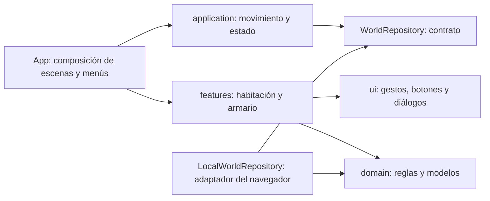

# Arquitectura de EmiVerse

La primera versión creció dentro de `App.tsx`. Los controles, la distribución de la casa, el armario y el guardado ahora tienen módulos separados. Se mantiene el mismo formato base de las partidas existentes y se añaden campos opcionales con valores iniciales para migrarlas.

## Responsabilidades y dependencias

- **`domain/`** contiene tipos, validación de partidas, límites de objetos, datos de muebles y reglas para intercambiar espacios del armario. No importa React, componentes, localStorage ni APIs de red. Sus funciones se pueden probar sin navegador.
- **`application/`** coordina el movimiento, el audio y el estado persistente. `useWorld` recibe un contrato `WorldRepository`; no conoce el mecanismo de almacenamiento.
- **`infrastructure/`** implementa ese contrato con almacenamiento local. El adaptador mantiene la clave de guardado anterior y carga las partidas a través de la validación del dominio. Si el almacenamiento falla, la interfaz lo informa y permite seguir jugando durante la sesión.
- **`features/room/`** reúne el dibujo de muebles, los objetos de la habitación y su selección/arrastre. **`features/wardrobe/`** contiene el editor del personaje y la organización del armario. Estos componentes reciben datos y callbacks; no leen ni escriben almacenamiento.
- **`ui/`** contiene controles reutilizables: un sensor de puntero para mouse/dedo/lápiz, botones que responden al toque directo y un diálogo accesible. No contiene reglas de prendas ni de personajes.
- **`App.tsx`** conecta las piezas y decide qué escena o menú se presenta. No implementa los gestos, la lectura de localStorage ni el bucle de animación.

`src/world.ts` conserva una exportación de compatibilidad para los imports iniciales; las reglas reales están en `domain/world.ts`.

## Patrones aplicados

Se usa **puerto/adaptador** para separar el guardado del juego, con **inyección de la dependencia** de persistencia en `useWorld`. Se usa **composición** para compartir la selección y el arrastre entre juguetes y muebles, y un sensor de entrada común entre los objetos y las prendas. El movimiento y el audio están encapsulados en hooks de aplicación; las reglas de organización son funciones puras.

Esto da responsabilidades pequeñas y contratos acotados. Un guardado remoto futuro puede implementar `WorldRepository` sin modificar los componentes del armario; un nuevo objeto utiliza `MovableObject` sin repetir el manejo del puntero. Los tipos y catálogos deben ampliarse de forma explícita al añadir muebles o prendas. No se introducen jerarquías de clases para objetos que solo necesitan datos y dibujo.

## Selección y distribución

Tocar un objeto lo selecciona. Arrastrar mueve una vista provisional; solo al soltar se confirma y persiste. Cancelar, perder el foco o cambiar el tamaño durante el gesto descarta la posición provisional. El movimiento del personaje se pausa mientras se manipula un objeto. Las flechas del teclado mueven el objeto enfocado; las flechas o WASD fuera de ese foco mueven al personaje.

Las coordenadas de objetos se guardan como porcentajes del escenario. Los límites tienen en cuenta el tamaño visible del objeto. Al cambiar de orientación se adapta la vista sin sobrescribir la distribución guardada. «Volver a su lugar» restaura solo el objeto seleccionado. Desde Aventuras también pueden seleccionarse los muebles si quedaron detrás de un control.

En el armario se intercambian dos espacios de forma inmutable, conservando todas las prendas. Arrastrar y tocar origen/destino ejecutan la misma regla. La ropa se puede ordenar independientemente de vestir al personaje; la corona requiere encontrar la sorpresa.

## Validación

Las pruebas de dominio verifican partidas anteriores, posiciones corruptas, conservación de prendas y límites de objetos. Playwright verifica los flujos completos con mouse y entrada táctil, cancelación, recarga, organización del armario, personalización y pantallas de celular/tablet/PC. La publicación sigue el flujo rama → PR → verificaciones → main → GitHub Pages.

## Personajes y entrada directa

`DraggableEntity` comparte el sensor de puntero y los límites entre muebles, objetos y personajes. `MovableObject` y `MovableCharacter` son adaptadores visuales pequeños. El catálogo de personajes incluye los creados por el usuario y a Leo; todos se muestran y pueden moverse. `domain/cast.ts` valida coordenadas por personaje y escenario sin depender de la UI. La migración añade esas posiciones sin cambiar personajes, muebles o ropa existentes.

La selección desde la bandeja hace accesible un personaje que esté detrás de otro. Tocar el suelo dirige únicamente al personaje activo; se guardan sus coordenadas al llegar, no en cada fotograma. El control direccional de pantalla fue retirado.
