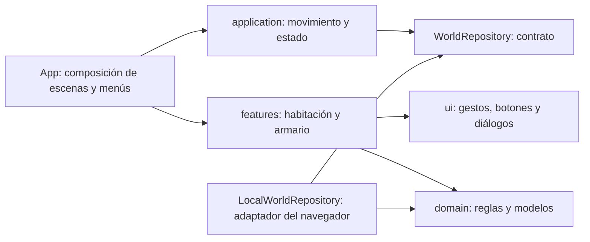

# Arquitectura de EmiVerse

La primera versión creció dentro de `App.tsx`. Los controles, la distribución de la casa, el armario y el guardado ahora tienen módulos separados. Se mantiene el mismo formato base de las partidas existentes y se añaden campos opcionales con valores iniciales para migrarlas.

## Responsabilidades y dependencias

- **`domain/`** contiene tipos, validación de partidas, límites de objetos, datos de muebles y reglas para intercambiar espacios del armario. No importa React, componentes, localStorage ni APIs de red. Sus funciones se pueden probar sin navegador.
- **`application/`** coordina el movimiento, el audio y el estado persistente. `useWorld` recibe un contrato `WorldRepository`; no conoce el mecanismo de almacenamiento.
- **`infrastructure/`** implementa ese contrato con almacenamiento local. El adaptador mantiene la clave de guardado anterior y carga las partidas a través de la validación del dominio. Si el almacenamiento falla, la interfaz lo informa y permite seguir jugando durante la sesión.
- **`features/room/`** reúne el dibujo de muebles, los objetos de la habitación y su selección/arrastre. **`features/wardrobe/`** contiene el editor del personaje y la organización del armario. Estos componentes reciben datos y callbacks; no leen ni escriben almacenamiento.
- **`ui/`** contiene controles reutilizables: un sensor de puntero para mouse/dedo/lápiz, botones que responden al toque directo y un diálogo accesible. No contiene reglas de prendas ni de personajes.
- **`App.tsx`** conecta las piezas y decide qué escena o menú se presenta. No implementa los gestos, la lectura de localStorage ni el bucle de animación.

`src/world.ts` conserva una exportación de compatibilidad para los imports iniciales; las reglas reales están en `domain/world.ts`.

## Patrones aplicados

Se usa **puerto/adaptador** para separar el guardado del juego, con **inyección de la dependencia** de persistencia en `useWorld`. Se usa **composición** para compartir la selección y el arrastre entre juguetes y muebles, y un sensor de entrada común entre los objetos y las prendas. El movimiento y el audio están encapsulados en hooks de aplicación; las reglas de organización son funciones puras.

Esto da responsabilidades pequeñas y contratos acotados. Un guardado remoto futuro puede implementar `WorldRepository` sin modificar los componentes del armario; un nuevo objeto utiliza `MovableObject` sin repetir el manejo del puntero. Los tipos y catálogos deben ampliarse de forma explícita al añadir muebles o prendas. No se introducen jerarquías de clases para objetos que solo necesitan datos y dibujo.

## Selección y distribución

En modo de juego, tocar activa el objeto directamente o abre el armario, sin confirmación. El botón Mover habilita la selección y el arrastre de objetos y muebles; Listo vuelve al juego. Arrastrar mueve una vista provisional; solo al soltar se confirma y persiste. Cancelar, perder el foco o cambiar el tamaño durante el gesto descarta la posición provisional. El movimiento del personaje se pausa mientras se manipula un objeto. Las flechas del teclado mueven el objeto enfocado; las flechas o WASD fuera de ese foco mueven al personaje.

Las coordenadas de objetos se guardan como porcentajes del escenario. Los límites tienen en cuenta el tamaño visible del objeto. Al cambiar de orientación se adapta la vista sin sobrescribir la distribución guardada. Desde Aventuras también pueden seleccionarse los muebles si quedaron detrás de un control. No hay acción de restaurar posiciones. Fuera del modo Mover, el mapa ejecuta directamente la acción del destino.

En el armario se intercambian dos espacios de forma inmutable, conservando todas las prendas. Arrastrar y tocar origen/destino ejecutan la misma regla. La ropa se puede ordenar independientemente de vestir al personaje; la corona requiere encontrar la sorpresa.

## Validación

Las pruebas de dominio verifican partidas anteriores, posiciones corruptas, conservación de prendas y límites de objetos. Playwright verifica los flujos completos con mouse y entrada táctil, cancelación, recarga, organización del armario, personalización y pantallas de celular/tablet/PC. La publicación sigue el flujo rama → PR → verificaciones → main → GitHub Pages.

## Personajes y entrada directa

`DraggableEntity` comparte el sensor de puntero y los límites entre muebles, objetos y personajes. `MovableObject` y `MovableCharacter` son adaptadores visuales pequeños. El catálogo de personajes incluye los creados por el usuario y a Leo; todos se muestran y pueden moverse. `domain/cast.ts` valida coordenadas por personaje y escenario sin depender de la UI. La migración añade esas posiciones sin cambiar personajes, muebles o ropa existentes.

La selección desde la bandeja hace accesible un personaje que esté detrás de otro. Tocar el suelo dirige únicamente al personaje activo; se guardan sus coordenadas al llegar o interrumpir el movimiento, no en cada fotograma. El control direccional de pantalla fue retirado.

## Casa conectada y cámara

`domain/house.ts` declara las habitaciones y sus puertas bidireccionales. `roomRoute` resuelve el trayecto sin depender de React o del navegador. Añadir una conexión no requiere reescribir el controlador de movimiento.

`useHouseNavigation` coordina las fases de caminar a una salida, confirmar la entrada, deslizar la cámara y continuar el recorrido si quedan habitaciones. El controlador de personajes notifica la llegada; el navegador de habitaciones decide el siguiente paso. Los menús o una nueva selección cancelan únicamente los trayectos pendientes.

`features/house` presenta puertas, selección de destino, escenarios y animación. La salida conserva una instantánea visual inerte del escenario anterior: no duplica controladores, eventos, identificadores vivos de personajes ni referencias SVG. La duración respeta movimiento reducido. La UI queda bloqueada solo durante el deslizamiento para evitar acciones sobre dos habitaciones a la vez.

El guardado añade cocina y dormitorio a las coordenadas de personajes y conserva sala/jardín, muebles y armario existentes. Se guarda la habitación actual al cruzar. El personaje entra por la puerta opuesta; regresar caminando actualiza su posición de forma natural, mientras que los demás mantienen sus posiciones guardadas.

## Suelo transitable

`domain/movement.ts` distingue pared y suelo y limita las coordenadas de los personajes. El toque sobre una pared se ignora; el controlador de caminar limita teclado y destinos, y `MovableCharacter` inyecta el mismo límite en `DraggableEntity` para que el arrastre tampoco permita volar. Las posiciones antiguas y los cambios de tamaño se ajustan visualmente a esos límites sin borrar la partida. Los muebles conservan su propia restricción: los cuadros y plantas colgantes sí pueden organizarse sobre la pared.

`DraggableEntity` separa activación y arrastre mediante callbacks. Los gestos consumen su clic de compatibilidad para evitar que un toque ejecute dos veces una acción o abra accidentalmente un diálogo después de arrastrar. Un arrastre fuera del modo Mover no activa ni desplaza el objeto.

## Interrupción y confirmación del guardado

`useCharacterMovement` distingue llegada (`onSettled`) de interrupción (`onInterrupted`). Ambas conservan la posición; solo la llegada puede confirmar el cruce por una puerta. `stop` captura el punto actual antes de abrir objetos o cambiar de personaje. Abrir menús, perder el foco, ocultar la página y `pagehide` detienen y guardan la caminata. La limpieza del controlador de un personaje no puede guardar las coordenadas del siguiente personaje.

`useWorld` mantiene la última partida confirmada en una referencia y aplica las actualizaciones funcionales en orden, aunque React agrupe varios eventos. El repositorio se escribe durante la acción, sin esperar a un efecto que podría no ejecutarse al cerrar o recargar. Los componentes conservan el mismo contrato inyectado; si el navegador impide guardar se mantiene la sesión en memoria y aparece el aviso existente.

## Interrupciones del arrastre de personajes

`DraggableEntity` conserva el último punto provisional en una referencia, incluso si React aún no dibujó ese fotograma. El callback opcional `onCancel` permite a los personajes confirmar ese punto ante `pointercancel`, pérdida de captura, cambios de tamaño, pérdida de foco y salida de página. La composición conecta esa interrupción con `placeActor`, que guarda y coloca al personaje sin activar puertas. Los objetos y muebles mantienen la cancelación de su cambio provisional. El sensor compartido también escucha `pagehide`, para cerrar un gesto antes de abandonar el juego.

## Tienda, bolsa y nevera

`domain/inventory.ts` define el catálogo de productos originales, la identidad de cada objeto y una única ubicación: bolsa, nevera o habitación con coordenadas. Las transferencias y el orden son funciones puras; no clonan objetos ni filtran por alimentos. Los objetos originales conservan una identidad reservada para que recogerlos no cree copias. La carga descarta registros corruptos o duplicados conservando el resto; las partidas anteriores reciben un inventario vacío y posiciones de personajes para la tienda.

`useInventory` coordina recoger productos, llevar objetos originales y transferirlos a través del `setSave` inyectado. No escribe directamente en localStorage. `features/inventory` dibuja el catálogo, el contenido de la bolsa y los estantes con arte SVG original. Reutiliza `usePointerGesture` para arrastre táctil y permite la misma transferencia seleccionando y pulsando su destino. Cancelar un arrastre no transfiere el objeto. Las listas se desplazan con Más; los objetos se pueden dejar en cualquier habitación y volver a recoger.

La tienda extiende el mapa al otro lado del jardín y conserva las conexiones anteriores. El movimiento de personajes, la distribución de muebles y la organización del armario mantienen sus contratos anteriores. `MovableObject` ahora admite identificadores genéricos para componer las compras con el mismo sensor de arrastre. Las zonas transparentes de los controles dejan pasar los toques al escenario.
